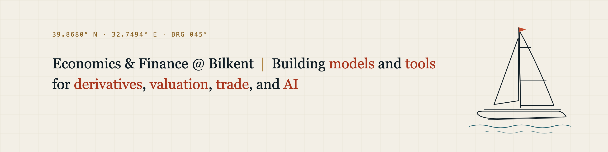

# Ada Acar
Economics & Finance at Bilkent ('27). I take financial and economic mechanisms apart with data, then build the **models** and **tools** that run on them.

- Site — [adaacar.boats](https://adaacar.boats)
- LinkedIn — [ada-acar](https://www.linkedin.com/in/ada-acar-6a3ba0329/)
- GitHub — [@AdaAcar](https://github.com/AdaAcar)
- Email — ada.acar25 [at] gmail [dot] com

## Now
- Derivatives: options pricing, Greeks and volatility surfaces on VIOP (Black-Scholes to Monte Carlo)
- Working paper: when to restrain AI adoption (dynamic optimization, labor share as a state variable)
- Orontes Sourcing: where to sell next, from open trade data (LightGBM, market × sector targeting)

## Selected work
| Project | What | Stack |
|---|---|---|
| [Exposure Cohort Selection](https://github.com/AdaAcar/exposure-cohort-selection) | Review funnel and cohort-composition engine for applicant selection | Python |
| [YKS Radar Institutional](https://github.com/AdaAcar/yks-radar-institutional) | Mock-exam ingestion, ability calibration and placement prediction for schools | Python |
| [Dealer Receivables Watch](https://github.com/AdaAcar/arcelik-uc09-dealer-receivables) | Dealer credit early-warning dashboard (course assignment, dummy data) | Python, JS |
| [Unlisted](https://github.com/AdaAcar/unlisted-backend) | Backend for a group-to-group social app | TypeScript, Next.js, Postgres |
| [Orontes Sourcing](https://orontes-sourcing.vercel.app) | Industrial spare parts sourcing for food manufacturers | Next.js, TypeScript, Tailwind |

## Stack
**Languages** — Python, TypeScript, SQL, Stata  
**Data / ML** — pandas, NumPy, scikit-learn, LightGBM
**Finance** — Black-Scholes, Monte Carlo, DCF, three-statement models, GARCH, DiD / IV  
**Web** — Next.js, React, Tailwind, Postgres, Drizzle

---
Away from the screen: Hobie 16, fishing, chess. Founder of Bilkent Snow Sports Club.
